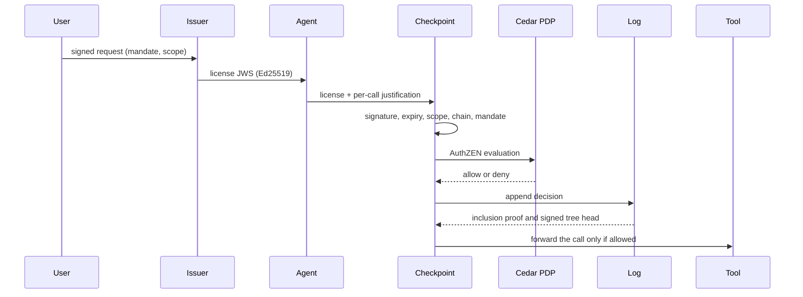

# agent-license

Verifiable mandates for AI agents.

An agent does not mint its own authority. A separate issuer signs a license that names the agent, the user it acts for, how it was delegated, and what it may do. At a checkpoint outside the agent, every call brings that license and a signed justification of why this call, on whose behalf, is the one being made. The checkpoint checks the signature, the lifetime, the scope, the delegation chain, and the mandate, asks a Cedar policy over the [OpenID AuthZEN 1.0](https://openid.net/specs/authorization-api-1_0.html) evaluation API, and appends the decision to a tamper-evident log.

This repository is a prototype of that flow. It is not a production trust service. Services bind to localhost and share a key directory.



## Mandates

A license carries exactly one:

| Mandate | Meaning |
| --- | --- |
| `direct_request` | The user asked for this exact action. The checkpoint allows only that action and location. |
| `user_goal` | The user set a goal. The agent chooses calls inside the granted scope. The justification must restate that goal. |
| `agent_initiated` | The agent is acting on its own, inside a fixed narrow ceiling: `clock.read`, `catalog.list`, and `memory.read`. |

A sub-agent can receive only a narrower license. Scope, budget, and expiry can shrink. They cannot grow, and the mandate type cannot change. The delegation chain is an RFC 8693 `act` claim: the outermost actor is the agent presenting the license.

The byte-level rules are in [spec/LICENSE-FORMAT.md](spec/LICENSE-FORMAT.md).

## Quickstart

Node.js 22 or newer and pnpm 9.

```sh
pnpm install
pnpm build
pnpm exec agentlicense keys init
```

`keys init` writes Ed25519 keys for an issuer, a log, `user:alice`, and two agents (`planner` and `researcher`) under `.agent-license/`.

Issue a license. The user request is signed locally with Alice's key; the issuer key then signs the license. The compact JWS is printed on stdout.

```sh
pnpm exec agentlicense issue \
  --user alice \
  --agent planner \
  --mandate user_goal \
  --goal "Summarize the primary calendar" \
  --actions calendar.read,calendar.create \
  --locations calendar:primary \
  --budget 10 \
  --ttl 3600 > license.jwt
```

Inspect the delegation chain:

```sh
pnpm exec agentlicense inspect --home .agent-license "$(cat license.jwt)"
```

Dry-run a call against the Cedar policy without starting the services:

```sh
pnpm exec agentlicense check \
  --license "$(cat license.jwt)" \
  --action calendar.read \
  --location calendar:primary \
  --why "Reading today's events is how the summary gets its facts."
```

A call outside the scope is denied:

```sh
pnpm exec agentlicense check \
  --license "$(cat license.jwt)" \
  --action mail.send \
  --location mail:outbox \
  --why "Sending mail is outside the calendar summary."
```

Hand a narrower license to a sub-agent:

```sh
pnpm exec agentlicense attenuate \
  --parent "$(cat license.jwt)" \
  --agent researcher \
  --actions calendar.read \
  --locations calendar:primary \
  --budget 3 \
  --ttl 600 > child.jwt
```

`agentlicense dev` starts the issuer, checkpoint, Cedar PDP, Merkle log, and a demo tool on `127.0.0.1` ports `43121` through `43125`. `agentlicense log verify --url http://127.0.0.1:43124` replays that log. The scripted walkthrough below exercises the same services on ephemeral ports.

## Demo

```sh
pnpm demo
```

The demo issues all three mandate types, allows an in-scope call for each, denies an over-scope call, denies a justification whose basis does not match the mandate, denies a call with no license, attenuates `planner` to `researcher`, rejects an attempt to add `mail.send`, allows the narrowed sub-agent call, denies a call the attenuated license dropped, and replays the log. A flipped leaf fails verification. The last line is `demo: ok`.

## Layout

| Path | Role |
| --- | --- |
| `spec/LICENSE-FORMAT.md` | The v1 license, justification, and log profile |
| `packages/core` | Types, Ed25519 JWS, attenuation, checkpoint rules, Merkle tree |
| `packages/cli` | The `agentlicense` binary |
| `packages/sdk` | `licensed(fetch)`, which attaches a license and a fresh justification |
| `services/issuer` | Signs licenses and attenuated licenses |
| `services/checkpoint` | HTTP proxy that rejects calls the license does not allow |
| `services/pdp` | AuthZEN evaluation API backed by Cedar |
| `services/log` | Append-only Merkle log and inclusion / consistency proofs |
| `policies/mandates.cedar` | The Cedar policy the PDP loads |
| `examples/demo` | The scripted walkthrough |

## Tests

```sh
pnpm test
```

Vitest covers signature verification, attenuation that refuses to widen, the three mandate rules (including a mismatched justification and an exhausted budget), RFC 9162 inclusion and consistency proofs through 32-leaf trees, the AuthZEN/Cedar decisions, and `licensed(fetch)`.

## SDK

`licensed(fetch)` returns a function with the fetch signature. It posts the JSON tool call to the checkpoint and sets `Agent-License` and `Agent-Justification`. The URL argument is not contacted; the checkpoint owns the upstream.

```ts
import { licensed } from "@agent-license/sdk";

const call = licensed(fetch, {
  license,
  agentPrivateKey,
  checkpoint: "http://127.0.0.1:43122",
  why: "Reading the calendar is how the summary is produced.",
  userRequest,
});

const response = await call("http://tool.invalid/ignored", {
  method: "POST",
  body: JSON.stringify({
    action: "calendar.read",
    resource: { type: "calendar", id: "primary" },
  }),
});
```

## What this prototype leaves open

The issuer is the only signer, so a checkpoint cannot re-prove that an ancestor scope was narrowed unless it is shown the parent license. The policy decision point trusts the checkpoint's booleans (`in_scope`, `basis_ok`, and the rest) and is meant to stay on localhost. Budgets live in the checkpoint process. The log key can rewrite history if an observer did not keep an older signed tree head. [ROADMAP.md](ROADMAP.md) records those limits and the MCP gateway that should follow this prototype.
