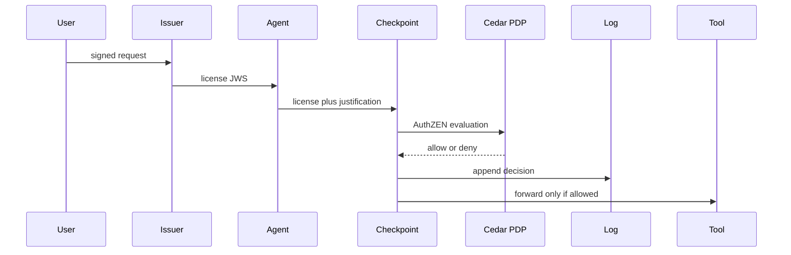

# Agent License

Signed agent licenses: which agent is calling, who it acts for, and what it may do. Checked outside the agent.

An issuer signs a license that names the agent, the user, the mandate, and the scope. Each call carries that license and a signed justification. A checkpoint that is not the agent checks the signature, the delegation chain, and a Cedar policy, then appends the decision to a Merkle log.

This is a prototype. `agentlicense dev` binds to `127.0.0.1`. It is not a production trust service.

## Install

Node.js 22 or newer and pnpm 9. The packages are not on npm yet. Publish names, once a `v*` tag runs the workflow: `agentlicense`, `@agentlicense/sdk`, `@agentlicense/core`.

```sh
git clone https://github.com/mlescaille/agent-town.git
cd agent-town
pnpm install
pnpm build
pnpm exec agentlicense --help
```

`pnpm install` builds the workspace. The repository is private until it is made public, so the clone requires access. When npm can read the repository, `npm install github:mlescaille/agent-town` installs it and the `agentlicense` command with it.

After the packages are published:

```text
npm install -g agentlicense
npm install @agentlicense/sdk
```

## 30 seconds

```sh
pnpm exec agentlicense keys init
pnpm exec agentlicense issue \
  --user alice \
  --agent planner \
  --mandate user_goal \
  --goal "Summarize the primary calendar" \
  --actions calendar.read,calendar.create \
  --locations calendar:primary \
  --budget 10 \
  --ttl 3600 > license.jwt
pnpm exec agentlicense check \
  --license "$(cat license.jwt)" \
  --action calendar.read \
  --location calendar:primary \
  --why "Reading today's events is how the summary gets its facts."
```

`keys init` writes Ed25519 keys under `.agent-license/`. `issue` prints a compact JWS. `check` dry-runs the call. A full walkthrough, including a denied call and a sub-agent, is in [docs/quickstart.md](docs/quickstart.md).

```ts
import { licensed } from "@agentlicense/sdk";

const call = licensed(fetch, {
  license,
  agentPrivateKey,
  checkpoint: "http://127.0.0.1:43122",
  why: "Reading the calendar is how the summary is produced.",
});
```

The runnable file is [examples/sdk-quickstart/main.mjs](examples/sdk-quickstart/main.mjs).

## Docs

| | |
| --- | --- |
| [Quickstart](docs/quickstart.md) | Install, issue, inspect, check |
| [Concepts](docs/concepts.md) | License, three mandates, delegation, checkpoint, policy, log |
| [CLI](docs/cli.md) | Every command and flag, generated from `agentlicense --help` |
| [SDK](docs/sdk.md) | `licensed(fetch)` and the core API |
| [Checkpoint](docs/checkpoint.md) | `agentlicense dev` on localhost |
| [FAQ](docs/faq.md) | What is real, including open pull request #1 |
| [Spec](spec/LICENSE-FORMAT.md) | Byte-level token rules |
| [Roadmap](ROADMAP.md) | MCP gateway and known limits |
| [AGENTS.md](AGENTS.md) | How an agent should present a license |

The site in `site/` is the same docs, using the landing page's CSS. `site/llms.txt` is the agent index. `site/.well-known/agent-license.json` is a proposed descriptor, not an IANA registration. The policy decision point's `/.well-known/authzen-configuration` route is implemented.

## Mandates

A license carries exactly one:

| Mandate | Meaning |
| --- | --- |
| `direct_request` | The user asked for this exact action and location. |
| `user_goal` | The user set a goal. The agent picks calls inside the scope. |
| `agent_initiated` | The agent acts on its own, inside a fixed read-only ceiling. |

A sub-agent can receive only a narrower license. On current `main` the delegation chain is an RFC 8693 `act` claim. The English on-behalf-of sentence is only in [pull request #1](https://github.com/mlescaille/agent-town/pull/1).



## Layout

| Path | Role |
| --- | --- |
| `packages/cli` | The `agentlicense` command |
| `packages/sdk` | `licensed(fetch)` |
| `packages/core` | JWS, attenuation, Merkle log |
| `services/` | Issuer, checkpoint, Cedar PDP, log |
| `policies/mandates.cedar` | The policy the PDP loads |
| `examples/demo` | Scripted walkthrough (`pnpm demo`) |
| `site/` | Landing page and docs, no build step |

## Tests

```sh
pnpm test
pnpm demo
```

`pnpm demo` ends with `demo: ok`.
